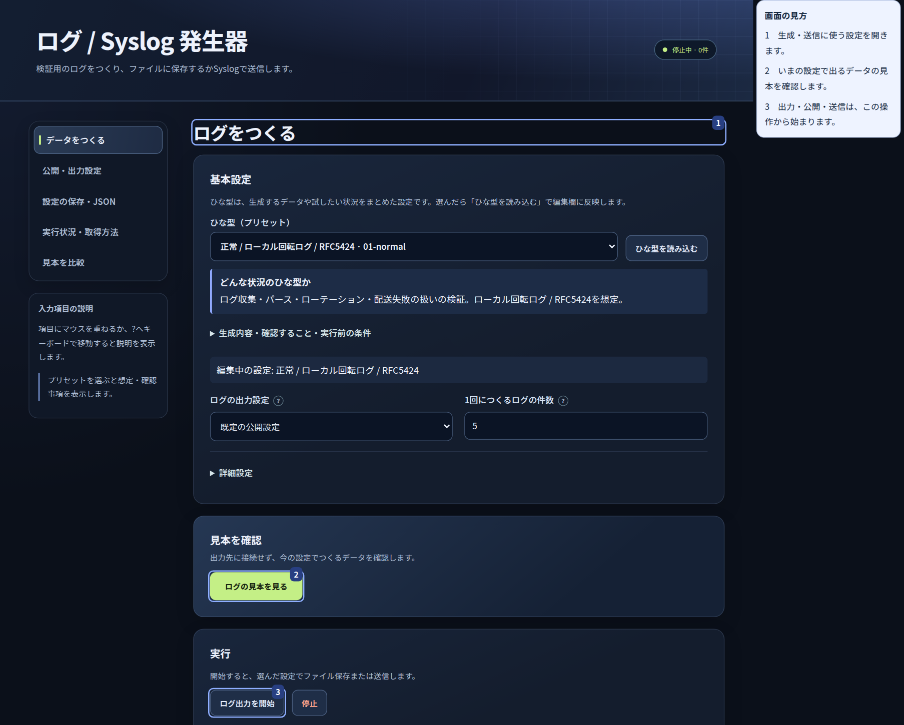

# ログ発生器 / 回転ファイル・Syslog

疑似ログをcaptureに記録して本文を読む手順を[初心者マニュアル](docs/user-manual.md)で確認できます。

## 起動して最初の画面を開く

Linux VMに Docker Compose を用意します。別端末からの接続やホスト側のマウントは[VM導入手順](docs/vm-compose.md)を参照してください。

```sh
python3 scripts/init_local.py --env-file .env
docker compose up -d --build
```

VMで `http://127.0.0.1:3643/` を開きます。メニューの「ヘルプ」から、見本の出し方、設定、APIを調べられます。 別端末から管理操作をする場合は[管理画面の認証](docs/vm-compose.md#管理画面の認証)も設定します。

開発時に直接起動する場合は Python 3.12〜3.14 と uv を使用します。必要なPythonは uv でインストールできます。

```sh
uv sync --frozen
DATA_DIR=./data uv run --frozen uvicorn app:app --host 127.0.0.1 --port 3643
```

## 操作と設定の資料

[8アプリの構成](docs/architecture.md)から役割と既定ポートを調べられます。

- [初心者マニュアル](docs/user-manual.md) · [ひな型を選ぶ・作る](docs/preset-guide.md) · [付属のひな型一覧](presets/README.md)
- [設定リファレンス](docs/settings-reference.md) · [JSONの書き方](docs/template-guide.md) · [AI向け作成ハーネス](docs/AI_TEMPLATE_HARNESS.md)
- [APIの使い方](docs/api-guide.md) · [用語集](docs/glossary.md) · [コードを拡張する](docs/code-reading-guide.md) · [変更履歴](CHANGELOG.md) · [レビュー対応表](docs/quality-review.md)
AIクライアント向けの接続方法は[CLI・MCPの使い方](docs/mcp.md)を参照してください。


設備・MES・アプリケーションの疑似ログを作成し、収集・パース・再送を試験します。

- 形式: JSON Lines、プレーン、RFC5424、RFC3164。facility / severity / host / app / メッセージテンプレートを編集。
- 配送: capture、ローカル回転ファイル、Syslog UDP / TCP / TLS。接続先・ポート・CA・証明書検証・待機時間をプロファイルで設定。
- TCPの境界: RFC6587 octet counting（UTF-8バイト数＋空白＋本文）または改行区切り。TLSはCAとホスト名を検証。
- ファイル: LOG_DIR/events.log、指定MiBで回転し、バックアップ数を制限。`scripts/init_local.py` はリポジトリ内の `data/logs` を作成し、その絶対パスをローカル設定の `LOG_DIR` に設定します。実際のホスト側パスは非公開の `.env` で確認してください。
- 重複、読めないヘッダー、異常値、エラー集中、長文、多言語・改行を同梱。配送先に接続できない場合やログファイルの書き込み・ローテーションに失敗した場合はpendingを維持し、次のtickで再試行。

`/source/events?limit=100&status=pending`で配送状況を確認できます。`/source/logs/download?limit=1000`は記録したメッセージを返します。UDPは配送確認なし、TCP/TLSは送信完了まで、ファイルはflushまでが判定範囲です。ファイルへの書き込みとDBの配送済み更新は別操作のため、障害後に重複し得ます。一般的な少なくとも1回配送として、受信側でevent_idを扱ってください。

OSの実ログや実際のサーバー負荷を採取するエージェントではありません。既存の監視基盤とは別の疑似データソースです。

## 操作ガイド

[ひな型の選び方・詳細設定の画面・自分のひな型の作り方](docs/preset-guide.md)

[](docs/images/operation-guide.png)

1. ログのひな型を選び、「ひな型を読み込む」を押します。
2. ログの出力設定と、1回の処理でつくる件数を確認します。
3. 「ログの見本を見る」で、本文・サイズ・重複や破損の見本を確認します。
4. 出力先を確認して「ログ出力を開始」を押します。

「詳細設定」を開くと、データ項目・型・生成規則・異常データなどを変更できます。接続方式や認証は「公開・出力設定」で管理し、設定を再利用する場合は「設定の保存・JSON」を使います。

## 設定の保存と運用

1. 「公開・出力設定」で方式・認証・接続先を保存。
2. 「データをつくる」でプリセットを読み込み、任意項目・型・生成器・異常ルールと個別設定を編集。
3. 「ログの見本を見る」で、見本の本文、UTF-8バイト数、TCP/TLSで区切りを含めたバイト数、重複・破損の有無を確認します。この操作では出力先への通信や書き込みは発生しません。各入力欄の説明は「?」から表示できます。
4. 停止してから開始すると新しい設定を適用。実行中は設定とプロファイルの版を固定します。画面からファイル保存や外部送信を開始するときは、表示された出力先とプロファイルの版を確認します。
5. 「設定を保存・JSONで編集」からJSONを編集・検証・取り込み・書き出し・プリセット保存できます。

24種類（通常12・異常12）のJSONを同梱。[一覧と詳細](presets/README.md)には想定・生成条件・確認事項を記載しています。再生成は`uv run python build_presets.py`。初回起動で未登録IDだけを追加し、保存済み設定は更新で上書きしません。

データ型はstring/integer/number/decimal/boolean/datetime/json。record_id、uuid、sequence、分布、重み付きchoice、テンプレート、参照、四則演算、時刻、NULL率、条件上書き、固着・ドリフト・欠落等を指定できます。共有パラメーターは`$名前`、テンプレートでは先行項目を参照。任意Pythonは実行しません。異常ルールの生成位置は各ドライバーが使う論理sequenceであり、必ずしもtickやAPIの読取順ではありません。

公開契約は[Spec JSON Schema](contracts/spec.schema.json)と[Profile JSON Schema](contracts/profile.schema.json)。Spec.version=1、内包するgeneratorは既存ツールと同じRunSpec.version=2です。SQL/ファイル/ストリーム専用の一部設定は内包モデルに残っていますが、このツールのフォームでは使う項目だけを表示します。

## 起動

Python 3.12、uv、Docker Composeを使用します。

```sh
uv sync --frozen
uv run python scripts/init_local.py --env-file .env
docker compose up -d --build
```

`.env`のAPP_PORTが画面のポート、BIND_IPは既定127.0.0.1。直接起動する場合は次のコマンドを使います。

```sh
DATA_DIR="$PWD/data" uv run uvicorn app:app --host 127.0.0.1 --port 8080 --workers 1
```

1アプリ1プロセス・1実行。起動後は停止状態で、画面または操作APIからの開始を待ちます。Docker再作成後もnamed volumeへ設定・データを保持。初期設定は小規模で、速度は保証値ではありません。interval_ms、batch_size、タグ/設備/件数等を増やす場合も、CPU・メモリ・容量上限を合わせて設定してください。

## 認証・データと運用

管理画面と `/api/*` の既定では認証を要求しません。[管理画面の認証](docs/vm-compose.md#管理画面の認証)を有効にすると、操作にもBasic認証が必要です。ローカルまたは信頼済みの検証環境向けです。既定のloopback公開を維持し、他端末から利用する場合は追加認証と到達元制限を別途設けてください。インターネットへの直接公開は避けてください。取得用`/source/*`の認証はプロファイルでnone/basic/bearer/api_key（X-API-Key）から別途選択します。APIへの変更操作は同一オリジンとapplication/jsonを要求。`/healthz` は稼働確認、`/metrics` は管理用のメトリクスです。暗号化HTTPが必要な経路では既存のTLS終端を使用してください。

秘密情報はFernetで暗号化保存し、読み戻し・JSON書き出しから除外。同じ接続範囲なら未入力の資格情報を保持し、接続範囲が変われば引き継ぎません。clear_secretsで明示削除できます。証明書・秘密鍵・CAは画面からconnection-filesへ権限600で配置可能。

DATA_DIRにはsettings.sqlite3、source.key、connection-files、永続データを保存します。DBと暗号鍵は一緒にバックアップし、秘密情報として管理してください。暗号鍵だけを失うと復号できません。リポジトリへ認証情報・実行データは含めません。

ホストメモリ余力（既定6GiB）、ディスク余力2GiB、storage_limit_mbを監視し、閾値で生成を停止します。Composeは既定512MiB/1CPU、非root、read-only root、ログ上限、負荷ガード連携用のラベルを設定。`storage_limit_mb`はDATA_DIR配下の上限で、別マウントのログはローテーションで制限します。

`uv run pytest -q`と`uvx ruff@0.17.6 check --select E4,E7,E9,F .`で検証。[検証記録](VALIDATION.json)に実接続と画面確認の範囲を記載しています。他ソースとの組み合わせとポート割り当ての参考例は[構成メモ](docs/architecture.md)を参照してください。実環境の接続情報は非公開の運用メモで管理してください。

## 外部監視用の管理ラベル

Composeの管理ラベルは既定で `factory.guard.managed=true` です。外部監視側との合意が必要な場合は、非公開の配備設定で `FACTORY_GUARD_LABEL_PREFIX` を指定できます。例えば説明用の値 `synthetic-guard` を指定すると、`synthetic-guard.guard.managed=true` になります。

既存の外部監視との互換性は未確認です。変更前に監視側が照合するラベル名と影響を確認してください。この設定は既存コンテナや監視設定を自動移行せず、デプロイも行いません。

## ライセンス

アプリ本体は[MITライセンス](LICENSE)です。同梱フォントとSwagger UIのライセンスは各配布ディレクトリにあります。
