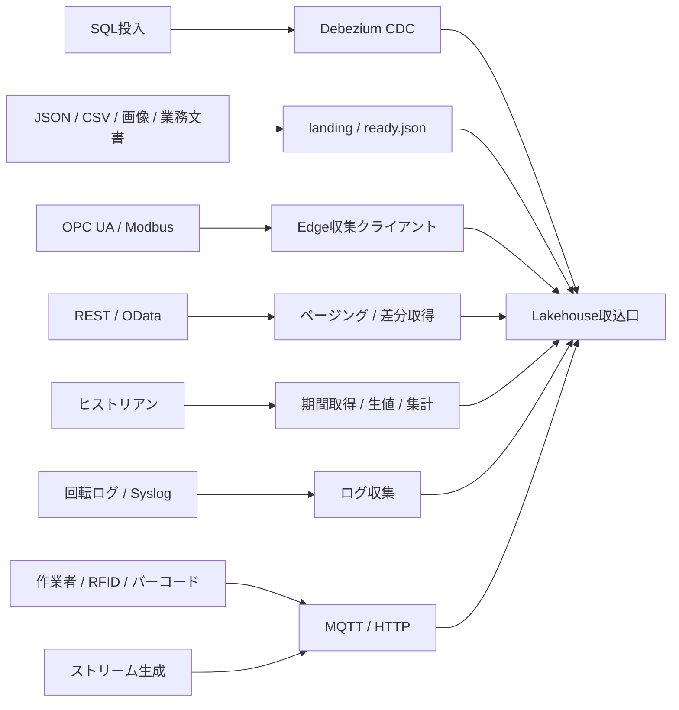

# データソース構成の参考例

| 種類 | リポジトリ | 画面ポート | 収集方法 |
| --- | --- | --- | --- |
| SQL | factory-mes-erp-simulator | 3560 | DBをCDC/クエリで取得 |
| ファイル | factory-file-generator | 3561 | landingのready.jsonを起点に取得 |
| ストリーム | factory-stream-simulator | 3562 | MQTT/Kafka/HTTP等 |
| 設備 | factory-equipment-simulator | 3640 | OPC UA 3645 / Modbus TCP 3646 |
| 業務API | factory-api-simulator | 3641 | REST / ODataサブセット |
| ヒストリアン | factory-historian-simulator | 3642 | 履歴REST / 期間指定 / 集計 |
| ログ | factory-log-simulator | 3643 | 回転ファイル / Syslog UDP・TCP・TLS |
| 識別 | factory-identification-simulator | 3644 | RFID・作業者イベント / MQTT・HTTP |

各アプリは独立したGitリポジトリ・設定・永続データとして構成できます。上表は組み合わせを検討するためのポート割り当て例であり、特定の稼働環境の接続情報ではありません。公開Compose単体は通常の独立Dockerネットワークで起動し、画面のbind先は既定でloopback（127.0.0.1）です。実際のポートは各リポジトリの `.env.example` とローカル設定で確認してください。

他端末から利用する構成では、利用者側の環境に合わせて接続先を設定してください。説明用のホスト名は `simulator.example.test`、アドレスは文書用の `192.0.2.10` を使用し、実アドレス・VPNアドレス・ネットワーク構成・資格情報は非公開の運用メモに分離します。これらの例示値は接続先として使うものではありません。

管理画面と操作APIはログイン不要です。Origin検査は利用者認証の代わりにはなりません。LAN・VPN・リバースプロキシ等を経由して他端末に公開する際は、到達元の制限と必要な追加認証を別途設けてください。インターネットへ直接公開しないでください。複数アプリでDockerネットワークを共有する場合も、利用者側でアドレスプールと到達範囲を設計してください。資格情報はホストの非公開設定へ保存します。

収集クライアント・Edge GatewayとCloudflare側の取り込みは別コンポーネントです。この追加はソースの模擬までを実装し、Cloudflareへの本番取り込みやAI/BIを自動配備していません。

横断試験にはequipment_id / lot_id / work_order_id等の業務キーと、event_time / 受信時刻 / event_idを分けて設定してください。各アプリの既定プリセットが全て同じ業務トランザクションに自動連動するわけではありません。共通パラメーター・同じseed・同じキー規則で揃え、異常の正解ラベルは別の検証結果に保持するのが適しています。
