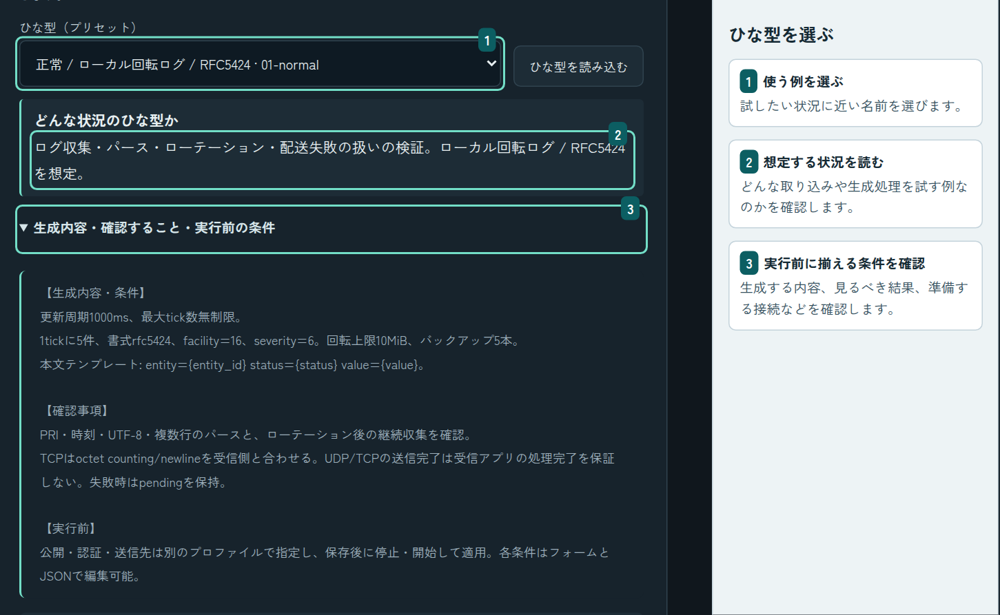
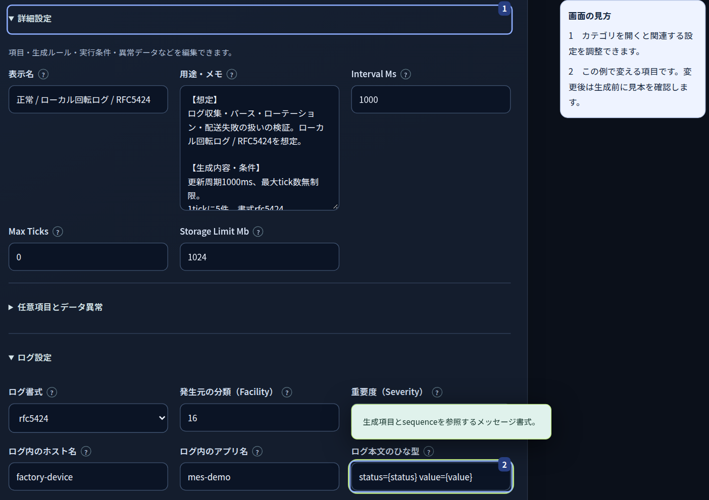
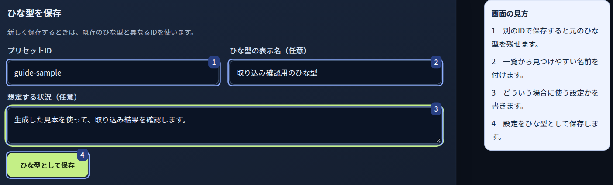
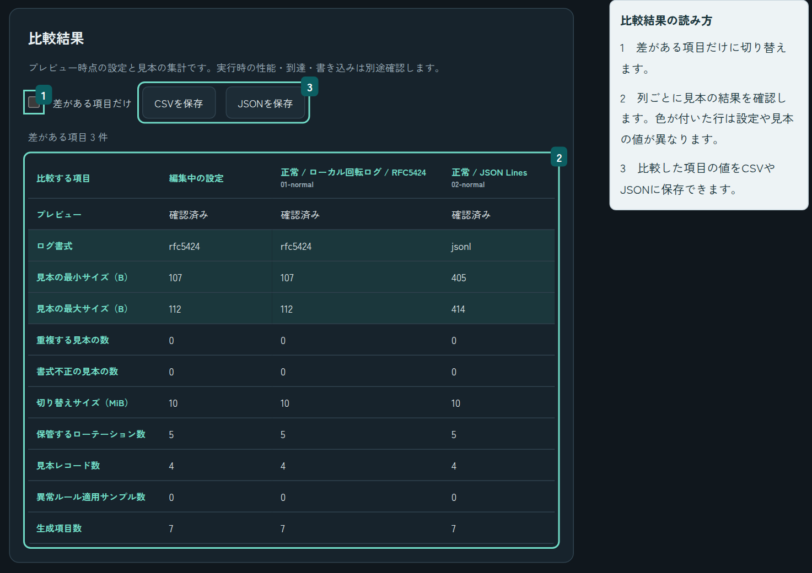

# ログ生成のひな型と詳細設定

ひな型（プリセット）は、生成するデータの項目・件数・書式や、再現したい異常をまとめた設定です。試したい状況に近いひな型を読み込み、見本を確認してから必要な設定を変えます。公開、書き込み、送信を始めるときは、画面の実行ボタンを使います。

## ひな型を選ぶ

**正常 / ローカル回転ログ / RFC5424（01-normal）** を例にします。

出力したログのヘッダーと本文を収集側が読み取れるか、ファイルが切り替わっても追跡できるか確認する場面です。

「基本設定」でひな型を選び、「ひな型を読み込む」を押します。出力するときは検証用のローカル出力先を選びます。

「どんな状況のひな型か」で用途を確認し、「生成内容・確認すること・実行前の条件」で作るデータや準備を読みます。

JSONを1行ずつ処理する場合は「正常 / JSON Lines（02-normal）」、不正なヘッダーを隔離する試験は「異常 / 壊れたヘッダー（15-anomaly）」を使います。

全ひな型の用途は[プリセット一覧](../presets/README.md)を参照してください。

## 詳細設定を変更して見本を見る

「詳細設定 → ログ設定」を開き、「ログ本文のひな型」を `status={status} value={value}` にします。中括弧の中には生成する項目名を入れます。

| 設定 | 変えられること |
| --- | --- |
| ログ書式 | RFC5424、JSON Linesなど、収集側が期待する書式を選びます。 |
| ログ本文のひな型 | 生成した項目を {status} のように書くと、本文に値を埋め込めます。 |
| ファイルを切り替えるサイズ（MiB） | ローカルファイルの回転サイズです。残す世代数は別の欄で決めます。 |

**見本での確認**　「ログの見本を見る」で status= と value= の後ろに生成値が入り、本文のバイト数も表示されることを確認します。ファイルの切り替えは実行後にローカル出力先で確認します。

## 自分のひな型を作って保存する

1. 上の例で編集した設定を残すには、「設定を保存・JSONで編集」を押します。今の設定がJSON欄に入った保存画面が開きます。
2. 「プリセットID」に `guide-log-short-body` のような新しいIDを入力します。半角英数字、ハイフン、下線が使えます。同じIDで保存すると、そのひな型を更新します。
3. 必要に応じて表示名と想定する状況を入力し、「ひな型として保存」を押します。画面で編集した設定は、JSON欄を書き直さず保存できます。
4. 生成画面の「基本設定」に戻り、新しく保存したIDを選んで「ひな型を読み込む」を押します。見本を出し、変更した条件が戻っていることを確認します。

たとえば値だけを読む処理を確かめるひな型なら、上の例で作ったひな型を読み込み、「ログ本文のひな型」に `value={value}` と入力します。見本では `{value}` が具体的な値に置き換わることを確認し、収集側に合わせた「ログ書式」と一緒に保存します。

共有するひな型には「状態と値だけを出すログ」のような表示名と、「ログ本文から状態と値を読み取る試験。」のような用途を書いておくと、次の人が選びやすくなります。接続先と認証は「公開・出力設定」で管理します。ひな型を別環境で使う場合は「JSONを書き出す」で持ち出し、利用先で接続設定を選び直します。

## 複数のひな型を比較する

メニューの「見本を比較」を開きます。見本のサイズや重複・書式不正、ファイルの切り替え条件を比べます。

1. 「名前・ID・用途」にキーワードを入力します。よく使うひな型は「お気に入り」を押すと、このブラウザーの「お気に入りのみ」で絞り込めます。「編集画面で選ぶ」を押すと、編集画面でそのひな型が選ばれます。「ひな型を読み込む」を押すと編集欄へ反映されます。
2. 比べたいひな型を最大3件選びます。画面で編集した設定も比べる場合は「編集中の設定を含める」をオンにします。検索条件を変えても選択は維持され、下の「比較する条件」に選んだIDが残ります。
3. 「見本を比較」を押します。複数の候補を順番にプレビューします。「残りを中止」を押すと、処理中のプレビューが終わった時点で残りを止めます。「要確認」の候補は編集画面で設定を見直し、通常のプレビューで詳細を確認します。
4. 比較結果は「差がある項目だけ」で絞り込めます。「CSVを保存」または「JSONを保存」で、ひな型ID・確認状況・比較項目の値を記録できます。接続情報や生成した本文は比較ファイルに含まれません。対象の設定を変えたら比較をやり直します。

[操作ガイドに戻る](../README.md#操作ガイド)
