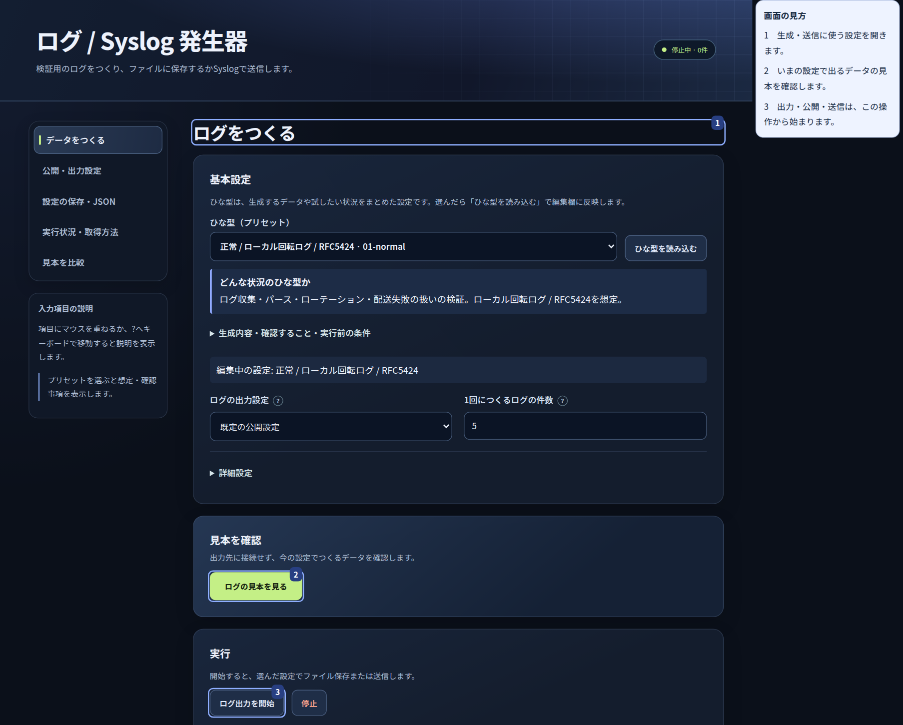

# ログシミュレーター 操作マニュアル

疑似のアプリ・設備ログを使い、パーサー、ログ転送、ローテーション、再試行を検証します。指定書式で本文を整形し、capture・ファイル・Syslogのいずれかへ出力します。

## 最初に試すこと

**疑似ログをcaptureに記録して本文を読む**。生成したメッセージを取得APIで確認できます。captureを選ぶと外部Syslogへ送らずに試せます。

[Docker Compose導入手順](vm-compose.md)で準備し、VMで `http://127.0.0.1:3643/` を開きます。

captureはアプリ内への記録です。Syslogはログを外部へ送る方式です。最初にcaptureを選び、時刻、重要度、本文が収集先で読める形式になっているかを切り分けます。

1. 「正常 / ローカル回転ログ / RFC5424」を読み込みます。「公開・出力設定」でcaptureを選びます。
2. 「ログの見本を見る」で本文とUTF-8のバイト数を確認します。RFC5424はSyslogの書式で、送信プロトコルとは別に選びます。
3. 「ログ出力を開始」を押し、少し記録されたら「実行状況・取得方法」で停止します。
4. 同じアドレスの `/source/logs/download?limit=10` で本文、`/source/events?limit=10` でイベントの状態を確認します。

## よくある質問

### ログが止まらず増えるのが心配です

実行状況で停止すると新しい疑似ログは増えません。小さく試す場合は詳細設定で最大tick数も決めてから開始します。

### ファイルとcaptureの違いは？

captureは取得APIから読めるアプリ内記録です。fileはVMの `LOG_DIR` 側に回転ログを書き出す方式です。

### TCP/TLSで受信側が複数行をまとめてしまいます

改行区切りかバイト数を付ける区切りかを、送信設定と受信側で揃えます。

## 停止と再起動

「実行状況・取得方法」で停止します。VMやコンテナを再起動しても手動開始まで疑似ログは増えません。Docker自身のサービスログは疑似ログとは別で、Composeでサイズと世代数を制限しています。

## 想定した結果が出ないとき

ファイルが増えない場合は出力プロファイル、ホストの `LOG_DIR`、コンテナUID 1000の書き込み権限を確認します。外部送信の不達は配送状態と受信側ログを照合します。

## 見本に表示される時刻

見本は書式を比較しやすいように固定した時刻を使います。実行した記録の時刻は、設定された日時ルールや実行時の記録から確認します。ログ本文の `message_template` が参照する項目は、生成項目に名前を揃えて定義します。

## 次に読む

- [ひな型を選ぶ・作る](preset-guide.md)
- [設定リファレンス](settings-reference.md)
- [JSONの書き方](template-guide.md)
- [APIの使い方](api-guide.md)
- [用語集](glossary.md)
